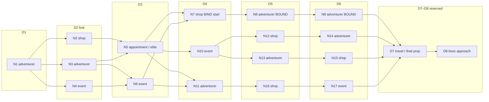

# Chapter route map — travelling atelier (Jonathan stamp 2026-10-13)

**Status:** Route map **LOCKED** (Jonathan 2026-10-13). **Doc id: `22`.** Filename kept; live spine is a **hand-authored route map with forks**. Timetable board shows that graph. Product display name **Wombaste** (repo `chaos-atelier`). Ugly nodes + edges shipped Client [#41](https://github.com/jc-renaisssance/chaos-atelier/pull/41) (`144c151`). Kind faces landed ([Route-graph board art (2026-10-20)](#route-graph-board-art-2026-10-20), #57–#59). **Elite telegraph shipped** (#66 / #67 / #68, Marker A, Scope A). Do not reopen. It does not add a screen.

**Supersedes** the free per-day **`E*` options board** from Design [#36](https://github.com/jc-renaisssance/chaos-atelier/pull/36) / Client [#37](https://github.com/jc-renaisssance/chaos-atelier/pull/37) (preview every windowed event per day, assign D1..(N−2) from an identical-shaped list). **Still superseded:** 2026-09-28 Round / schedule board (`CHAPTER_ROUND_COUNT=8` as global law, R1..R8, `crafts_max=4`); 1-of-3 card lineup ([22-chapter-flow](22-chapter-flow.md)).

Kept: travelling atelier. Craft = stamina ([27](27-craft-mode-stamina.md)). Boss-client draw unchanged (`28` / `29`). Scrap Duelist / `appt_*` stay appointments — **not** Dex Adventurers ([31](31-dex.md)). Piece cap **GONE**. `map.day_count` **stays** a map setting (current map **8**; last 2 reserved). M1 panel = **type + id**; fancy titles **Later**.

## Fiction

The atelier rides a **horse-car / wagon**. Each chapter is one stretch of road to the destination **chapter boss**. The stretch is a **hand-authored route map**: corridors, forks, and bound multi-day blocks — **StS-like**, **not** seed-generated sprawl, **not** a free options list under every day.

Combos are **bound multi-day blocks on the graph**, not stacked modifiers the player independently equips.

## Constants (Phase-1)

| Key | Value | Notes |
|---|---|---|
| Chapters per run | 3 | Unchanged |
| Day count | **`map.day_count`** / dump **`CHAPTER_DAY_COUNT`** | **Map setting — not global law.** Current wagon map = **8**. Later maps may be **3** or **12**. |
| Piece cap / `crafts_max` | **GONE** | Unlimited pieces per chapter. Stamina per craft session **stays** ([27](27-craft-mode-stamina.md)). |
| Boss telegraph | Chapter start | Boss announced before spend |
| Reserved days | Last **2** relative to `N = map.day_count` | Graph days = **D1..(N−2)**. Current 8-day map: **D7** travel / final prep, **D8** boss approach. Appointments cannot claim reserved days. |
| Shop visits / chapter | **1–3** | From **graph design** (how many `shop` nodes sit on a complete path). **Not** a hard UI ban on picking shop. |
| Fork width | **2–4** visible next options | Only at forks. Corridor / bind / reserved → **no** options panel. Current test forks are 2 or 3. Do not add an edge to force 4. |

Until-M2 numbers (person stats, pressure, gold, reps, which `evt_*` a node resolves) are [33](33-until-m2-tuning.md), awaiting stamp. This file’s graph, Day names, `crafts_max` gone, last-2 rule, and fork width stay. Event **identity** is a pool row on a `kind=event` node, not a day-strip script, and not the free `E*` board.

### Reserved last-2 (relative to map length)

```
N = map.day_count
graph days = D1 .. D(N-2)
reserved   = D(N-1)  travel / final prep
             D(N)    boss approach
```

| Map `day_count` | Graph / assignable | Reserved |
|---:|---|---|
| **8** (current) | D1..D6 | D7 travel / final prep · D8 boss approach |
| 3 (later map) | D1 | D2 travel / final prep · D3 boss approach |
| 12 (later map) | D1..D10 | D11 travel / final prep · D12 boss approach |

Do **not** hardcode 8 as law. Do **not** hardcode “rounds 7–8”. Reserved days are **not** graph nodes the player picks.

---

## Law — route-map model

The chapter is a **directed graph** the designer authors. Nodes occupy graph days D1..(N−2). Edges go forward (a node on day D points at node(s) on day D+1, or at the start of a bind whose first day is D+1). The player **walks one path**. Past nodes are **frozen**.

This is **not**:

- a seed-grown StS act map (no procedural sprawl)
- a per-day windowed `E*` pool (no “every event whose window includes today”)
- stacking arbitrary combos on the same days

### Node types

| Kind | Dump / M1 type | What it does |
|---|---|---|
| **adventurer** | `adventurer` | Walk-in / listed order that day (`adv_*` on the row). |
| **shop** | `shop` | **Display: Market.** Buy / sell / **refresh** from the **chapter-shared bank** — **[32](32-shop-and-events.md)**. Wire `kind` stays `shop`. **M1 tab = materials. M2 = Staffs / Skills / Gear** (`staff_*` / `sk_*` / `artifact_*`). Reshape Later. |
| **appointment** | `appointment` | Named / important order. **StS-elite analog.** Scrap Duelist stays here. **Not** Dex Adventurers. |
| **event** | `event` | Travel / road **text resolve** — **[32](32-shop-and-events.md)**. `ref_id` → `evt_*`. No craft session. |
| **reserved** | `reserved` | Last-2 only (travel / final prep + boss approach). Not player-picked. |

Keep **`adv_*` / `appt_*` / `evt_*`** on the row when they exist. Market shelf is drawn from `market_bank_c1` (`ref_id` null) — [32](32-shop-and-events.md). **M1:** show **type + id** with display type **market** — e.g. `market · N2` (wire `kind=shop`). Fancy titles **Later**. Do **not** invent title copy.

Prep craft / rest-dig are **Later** node kinds — **not** on the C1 sample map. Phase-1: **one** primary action per day, from the current node.

Taking an order enters **craft mode once** for that order. Multi-piece = **one** parallel session ([27](27-craft-mode-stamina.md)). **No piece cap.** Decline: Phase-1 once per chapter at −reps (Later: reschedule at rep cost).

### Fork choice

A **fork** is a node with **2–4 outgoing** edges. When that choice is live, the timetable **options panel** lists those next nodes (type + id). The player picks **one**. Nodes not on the chosen edge are **cut** (dim / not offered later).

Do **not** show the same option list under every day. Options are **the outgoing edges from the current node**, not a global pool filtered by window.

### Corridor

Exactly **one** outgoing edge → **no choice → no options panel**. The next node is pinned on the next day.

### Binds (combos)

A **bound multi-day block** is a designer-authored consecutive chain (e.g. shop → adventurer → adventurer over D4–D6). Entering the **first** node of the block **pins the rest**. Bound days show the pinned nodes only — **no free options panel**.

Binds are **path fragments on the graph**, not a second layer the player stacks. One-combo vs stack = **corridor + forks** (a path through overlapping choices), not “equip combo A and combo B onto the same days.”

### Unbound days

A graph day that is **not** inside a bind, **not** reserved, and **not** a single-exit corridor. If the current node still has remaining outgoing options that day, the player makes a **limited free pick** from those remaining options (still 2–4, still type + id). If none remain besides a single corridor edge, there is no panel.

### Draft future (LOCKED — Jonathan 2026-10-13)

Future **unbound** days are **draft only**. The player may **preview / draft** a legal remaining path on the graph (ghost type + id). That draft is **not** the pick.

- The **real pick is confirmed when that day is current** (live fork or unbound remaining options on the current node).
- The player may change the draft as often as they like while those days are still future.
- A draft that is no longer reachable (cut by a confirmed fork) is discarded.
- **Past** and **current / entered bound blocks stay frozen.** Drafting cannot move a resolved node, un-pick a taken fork, or edit a bind already entered. Remaining days of an entered bind are pinned, not drafts.

Do **not** treat a drafted future node as `route_path` / `current_node_id` / `day_action`.

### Frozen past

Played days are frozen. The player cannot move a resolved node, cannot un-pick a taken fork, cannot edit a bind already entered.

### Shop visits 1–3

Count `shop` nodes on the **complete path** D1..(N−2) (reserved last-2 do not count). Authored so **every** full path has **1–3** shops. Client does **not** grey-out shop because `shops_taken == 3`. A path with 0 shops or 4 shops is a **map bug**, not a UI rule. What a market **does** when entered = [32](32-shop-and-events.md) (buy/sell/refresh/**enchant** from the chapter bank; display Market; reshape Later).

### `map.day_count`

N is per map. This stamp authors **one** concrete graph for the current wagon map (`day_count` = 8). Later maps stamp their own graph + N. Do not reuse the C1 node table as law for a 3-day or 12-day map.

---

## Sample map — C1 / current wagon (`day_count` = 8)

**Map id:** `map_m1` (C1 current wagon). Graph days **D1..D6**. **D7–D8 reserved** on every path.

Locks for this sample: D1 = fixed first-customer adventurer; ≥2 forks; ≥1 bound multi-day combo; appointment = StS-elite analog; every complete path has 1–3 shops (this map lands **1 or 2**).

### Graph (D1..(N−2); D7–D8 reserved)



ASCII (same graph):

```
D1            D2              D3                 D4               D5               D6            D7     D8
────────      ────────        ────────           ────────         ────────         ────────      ─────  ─────
N1 adv ─┬───► N2 shop ──────► N5 elite ───┬────► N7 shop ═══════► N8 adv ════════► N9 adv ──┐
        │                     ▲           │       BIND start       BOUND            BOUND  │
        ├───► N3 adv ───┬─────┘           ├────► N10 event ─┬───► N12 shop ──────► N14 adv ─┼──► R7 ─► R8
        │               └────► N6 event ─┐│                 └───► N13 adv ───────► N15 shop─┤
        └───► N4 event ──────────────────┴┴────► N11 adv ───────► N16 shop ──────► N17 event┘
```

`═` = bound block `combo_market` (D4–D6). `─` / `├` / `┬` = ordinary edges. Overlap: N2 and N3 can both reach elite **N5**; N3 and N4 can both reach event **N6**; N5 and N6 can both enter the bind **N7** or the adventurer corridor **N11**.

### Nodes

| id | Day | Kind | Ref | Notes |
|---|---|---|---|---|
| **N1** | D1 | adventurer | `adv_halden_rook` | Fixed first-customer. Corridor into Fork 1. |
| **N2** | D2 | shop | — | Fork 1 option. Shelf from `market_bank_c1` ([32](32-shop-and-events.md)) |
| **N3** | D2 | adventurer | `adv_vex_bramble` | Fork 1 option; then 2-exit onto N5 or N6 |
| **N4** | D2 | event | `evt_c1_heat_mirage` | Fork 1 option. Resolve in [32](32-shop-and-events.md) |
| **N5** | D3 | appointment | `appt_scrap_duelist` | **Elite analog.** From N2 (corridor) or N3. |
| **N6** | D3 | event | `evt_c1_ashfall` | From N3 or N4. Resolve in [32](32-shop-and-events.md) |
| **N7** | D4 | shop | — | **BIND start** `combo_market`. Shelf from `market_bank_c1` ([32](32-shop-and-events.md)) |
| **N8** | D5 | adventurer | `adv_quill_lumen` | Bound |
| **N9** | D6 | adventurer | `adv_kite_thornreel` | Bound |
| **N10** | D4 | event | `evt_c1_scrap_market` | Unbound fork option from N5. Resolve in [32](32-shop-and-events.md) |
| **N11** | D4 | adventurer | `adv_tide_glass` | From N5 or N6; then corridor N16→N17 |
| **N12** | D5 | shop | — | Unbound pick from N10. Shelf from `market_bank_c1` ([32](32-shop-and-events.md)) |
| **N13** | D5 | adventurer | `adv_quill_lumen` | Unbound pick from N10 |
| **N14** | D6 | adventurer | `adv_kite_thornreel` | Corridor from N12 |
| **N15** | D6 | shop | — | Corridor from N13. Shelf from `market_bank_c1` ([32](32-shop-and-events.md)) |
| **N16** | D5 | shop | — | Corridor from N11. Shelf from `market_bank_c1` ([32](32-shop-and-events.md)) |
| **N17** | D6 | event | `evt_c1_salt_spray` | Corridor from N16. Resolve in [32](32-shop-and-events.md) |
| **R7** | D7 | reserved | — | Travel / final prep — all paths |
| **R8** | D8 | reserved | — | Boss approach — all paths |

Same `adv_*` may appear on **mutually exclusive** branches (N8 vs N13 vs N14, etc.). A single path never double-plays the same person. Do not invent display titles for these rows.

### Bind

| `bound_block_id` | Days | Nodes | Sequence |
|---|---|---|---|
| `combo_market` | D4–D6 | N7 → N8 → N9 | shop → adventurer → adventurer |

Picking **N7** at the D4 fork enters the bind. D5 and D6 show N8 / N9 pinned — **no** options panel.

### Forks (this map)

| From | Day of choice | Options (2–4) |
|---|---|---|
| N1 | D1 resolve → D2 | **N2** shop · **N3** adventurer · **N4** event |
| N3 | D2 resolve → D3 | **N5** appointment · **N6** event |
| N5 | D3 resolve → D4 | **N7** shop (bind) · **N10** event · **N11** adventurer |
| N6 | D3 resolve → D4 | **N7** shop (bind) · **N11** adventurer |
| N10 | D4 resolve → D5 | **N12** shop · **N13** adventurer |

Corridors (no panel): N2→N5 · N4→N6 · N7→N8→N9 · N12→N14 · N13→N15 · N11→N16→N17 · every path → R7→R8.

### Example full paths (shop counts)

Reserved D7–D8 trail every path. Shop count = `shop` nodes on D1..D6.

| Path | Route | Shops | Count |
|---|---|---|---:|
| **A — Market elite bind** | N1 → **N2 shop** → N5 elite → **N7 shop** → N8 adv → N9 adv | N2, N7 | **2** |
| **B — Road elite, late shop** | N1 → N3 adv → N5 elite → N10 event → N13 adv → **N15 shop** | N15 | **1** |
| **C — Event corridor** | N1 → N4 event → N6 event → N11 adv → **N16 shop** → N17 event | N16 | **1** |

Path A is the bound combo. Paths B and C are unbound / corridor. Overlap example (not required to play): N4 → N6 → **N7** also enters `combo_market` (1 shop: N7 only).

This sample’s complete paths have **1 or 2** shops — inside the **1–3** law. A later map may author a 3-shop line. Do **not** cap shop picks in UI.

Later maps stamp their own graph + `map.day_count`. Do not reuse this node table as law for a 3-day or 12-day map.

---

## Timetable UX

Labels are **D1..DN** — never R1. The live board is the **authored route graph** (nodes + edges), not a day strip with a hidden map. Skill is reading corridors, forks, the elite, and the bind — then drafting ahead and confirming when the day is current.

### Chapter-start UX (LOCKED)

1. Kingdom newspaper announces the **boss** (`26`) — not the boss-client.
2. **Graph board** opens: C1 nodes + edges visible (ugly M1: type + id). Days D1..N are columns / slots **on that graph**.
3. **D1 is fixed** (N1 first-customer). No options panel on D1.
4. Player does **not** assign the whole chapter from a per-day `E*` list. They may **draft** a future unbound path (ghost). Confirm happens when each day is current.
5. Reserved last-2 are visible, **not** pickable.
6. When a fork is **current**, pick 1 of 2–4 **next** nodes (draft may pre-highlight a legal option; it is not committed until confirm).

### Board states (LOCKED)

| State | Options panel | What the board shows |
|---|---|---|
| **Fork** (2–4 next, **current**) | **Yes** — those next nodes, type + id (`shop · N7`). Keep `adv_*` / `appt_*` / `evt_*` on the row. | Current node live; outgoing edges offered |
| **Corridor** (exactly one next) | **No** | Next node pinned, type + id |
| **Bound** (inside `combo_market`) | **No** | Remaining bind nodes **pinned / frozen** (not drafts) |
| **Reserved** | **No** | D7 travel / final prep · D8 boss approach |
| **Frozen past** | **No** | Played node, not clickable-to-reassign |
| **Draft future** (unbound, not current) | **No** as a commit panel — ghost the drafted path only | Preview / draft highlight; changeable until that day is current |
| **Unbound remaining picks** (current) | **Yes** — only remaining outgoing options from *this* node | Same M1 type + id rows; confirm writes `route_path` |

**No choice → no options panel.** Do not open an empty “pick E*” drawer on corridor / bind / reserved / D1 / draft-only future.

**M1 copy:** type + id only. Wire type ∈ {`shop`, `adventurer`, `appointment`, `event`, `reserved`}. **Display** `shop` as **market** (`market · N2`). Fancy titles **Later**. The ahead-of-time elite badge is [Elite telegraph (2026-10-21)](#elite-telegraph-2026-10-21) — a corner mark on the appointment card, not a title and not the kind face. Kind-face sockets (one chip per kind) stay [Route-graph board art (2026-10-20)](#route-graph-board-art-2026-10-20).

### Mid-chapter

**LOCKED:** future unbound = draft only; real pick when the day is current. Past and entered binds stay frozen. Cut branches stay cut (and drop any draft that used them).

Phase-1: **one** primary action per day.

---

## Piece cap — GONE (LOCKED)

- **No** `crafts_max`. **No** garments-per-chapter ceiling.
- Stamina per craft session **unchanged** (`12 * N` draft, Finish-only, [27](27-craft-mode-stamina.md)).
- `cant_craft` because `crafts_done == crafts_max` is **GONE**. Do not emit that fail.
- Mid-fail from **other** causes may stay (`24`: F + hp>0 + aid 0 for a true session-open fail). Empty zone at Finish is **not** `cant_craft` (`27`).

## Boss

- Announced at chapter start (favor / punish / environment from `17`). Newspaper announces the **boss**, not the client (`26`).
- After the day budget (including reserved last-2), **draw one adventurer from the M1 4-job pool** (`28` / `29`: Knight, Mage, Blade Dancer, Lagoon — **LOCKED** Jonathan 2026-10-08) → **craft that job’s order constructions** → that **adventurer** fights the announced boss. Sim uses **that client's gear**. Player is not the fighter (`03`, `17`, `28`). Do **not** draw Wizard / Hexer / Outrider / Oathbound in M1.
- Pool is **shared across all bosses / chapters**, by **job title**. Draw is **independent** of `chapter_boss_id`. Order constructions are the listed `con_*` for that job.
- Boss fail (boss-client / adventurer dead / hard loss): **`run_over`**, no retry (Phase-1 hardcore).
- **Appointments stay appointments.** Scrap Duelist and other mid-chapter named clients are `appt_*`. They are **not** the boss-client. Do not pin Scrap Duelist to reserved days or the boss beat. Do **not** put `appt_*` on the Dex Adventurers tab (`31`).
- Boss-fight portraits and extra battle widgets stay **Later**. Named adventurer busts already landed (`assets/adv/`, #54 / #55) — do not reopen them and do not put those busts on route nodes. Kind-face sockets are [Route-graph board art (2026-10-20)](#route-graph-board-art-2026-10-20). Job catalog stays `28`.

---

## Client needs (Ulquiorra)

Docs only this stamp — sketch for the next Client PR. No `src/` here.

1. **No piece cap.** Do not block craft when `crafts_done` is high. Do not show a 4/4 garments meter. Do not emit `crafts_max`. Do not fire `cant_craft` because of piece count.
2. **Day labels.** Timeline says **D1..DN** (N = `map.day_count`). Never R1. Current map N=8.
3. **Replace the free `E*` options board** ([#36](https://github.com/jc-renaisssance/chaos-atelier/pull/36)/[#37](https://github.com/jc-renaisssance/chaos-atelier/pull/37)). Do **not** list every windowed event whose day includes today. Do **not** assign all of D1..(N−2) from that list at chapter start.
4. **Graph board now, art Later (Nnoitra).** M1 Client ships a **simple route-graph layout** — nodes + edges, ugly — so later art / UI can plug in. **Not** a day strip that hides the map. Do not invent chrome or node art this stamp. **Shipped:** ugly layout Client #41 (`144c151`). Kind-face sockets for that layout are [Route-graph board art (2026-10-20)](#route-graph-board-art-2026-10-20). Wire them only after Jonathan stamps. Do not build a second board.
5. **Route graph data.** Load the authored C1 map (`map_m1` nodes + edges + `combo_market`). D1 = N1. D7–D8 reserved.
6. **Options panel only at a current choice.** Fork or unbound remaining picks **on the current day**: 2–4 next nodes, **M1 type + id** (`shop` / `adventurer` / `appointment` / `event` + `N2`…). Keep `adv_*` / `appt_*` / `evt_*` on the row. Fancy titles **Later**. **No choice → no panel** (corridor, bind, reserved, D1, frozen past, draft-only future).
7. **Draft future.** Player may ghost a legal unbound path. Draft is **not** a confirm. Confirm when that day is current. Do not write drafts into `route_path`.
8. **Binds.** Entering N7 pins N8 and N9. Bound days are frozen — not drafts, not re-pickable.
9. **Frozen past.** Played nodes cannot be moved.
10. **Shop 1–3 from the graph.** Do **not** forbid picking a shop node because the run already visited k shops.
11. **Reserved last-2.** Current map: D7 travel / final prep, D8 boss approach. Relative to N on other maps.
12. Scrap Duelist stays an appointment row on **N5** — not Dex Adventurers.
13. Dump `phase=schedule` **kept** (on the graph board). Do not invent `phase=planner` / `phase=route` this stamp.
14. **Market visit + event resolve ([32](32-shop-and-events.md)).** When current `kind=shop`: enter ugly **market** shell (display Market; dump `day_action=shop`); buy/sell/**refresh**/**enchant** from `market_bank_c1` (**M1 tab = materials only** — shipped #45; do not reopen). **M2** Staffs / Skills / Gear catalogs live in `32` — that Client has landed (#47 / #49 / #53). Do not reopen it from the elite packet. Enchant stamps `mat_enchant_id` + shiny overlay on one owned `mat_*` copy (materials only). Exit resolves the day; dump `market_*` / `market_enchants` / gold / `deck_material_count` (+ M2 staff/skill/artifact keys when that Client lands). When current `kind=event`: enter text resolve from `ref_id` → `evt_*`; one choice; dump `event_id` / `event_choice_id` / `event_deltas`. Do **not** grey-out market picks. Do **not** invent reshape / owners / art.
15. **Elite badge — after the 2026-10-21 stamp, not this docs drop.** Wire sketch is [Elite telegraph (2026-10-21)](#elite-telegraph-2026-10-21). Do not ship the overlay in the kind-face Client. Do not treat this docs PR as that wire.

## Test logs (Szayelaporro)

Log on chapter-start (graph loaded), on each fork pick, on bind enter, and on each day resolve. **Not** all of these must become `20` Required — Required list is in [20](20-harness-stamp.md).

| Key | When / what |
|---|---|
| `CHAPTER_DAY_COUNT` | = `map.day_count` (current map **8**) |
| `day_index` / `days_left` | Live day; remaining including reserved |
| `route_map_id` | `map_m1` on current wagon |
| `route_nodes` | `{ node_id, day_index, kind, ref_id, bound_block_id }` — `ref_id` = `adv_*` / `appt_*` / `evt_*` / null. Market shelf is **not** `ref_id` — `market_bank_c1` ([32](32-shop-and-events.md)). Wire `kind=shop` = display Market |
| `route_edges` | `{ from, to }[]` |
| `route_path` | Node ids **confirmed**, in order (includes reserved R7/R8 once reached). Never drafts. |
| `draft_path` | Ghosted future node ids (optional). Not Required. Must not overlap frozen past / entered bind. |
| `current_node_id` | Live node |
| `bound_block_id` | `combo_market` while inside the bind; else null |
| `fork_options` | Visible next `{ node_id, kind, ref_id }[]` — empty when no choice |
| `day_action` | Current node kind (`adventurer` \| `shop` \| `appointment` \| `event` \| `reserved`) — null before D1 play / on newspaper |
| `crafts_done_this_chapter` | Unbounded piece counter (optional telemetry) |
| `cant_craft` | Only true session-open fail — **never** because of piece count |
| `appt_*` / `adv_*` / `evt_*` | On the node row; Scrap Duelist is `appt_*`; C1 events in [32](32-shop-and-events.md) |
| `market_*` / `gold` / `event_*` | Market visit + event resolve dumps — [32](32-shop-and-events.md) / [20](20-harness-stamp.md). Includes `market_enchants` + **M2** staff/skill/artifact keys. `day_action=shop` is the wire |

**Do not emit as live law:** windowed `event_pool` (`E*` + `windows` + `fixed`) and free `day_assignments` `{ day_index, event_id }` from the #36/#37 board.

**Asserts (route map)**

1. No `crafts_max` field. No `cant_craft` from `crafts_done`.
2. `CHAPTER_DAY_COUNT == map.day_count` — current-map dumps use **8**; do not assert 8 on a later 3- or 12-day map.
3. Graph node `day_index` ∈ `1 .. CHAPTER_DAY_COUNT-2`. Reserved last-2 are `kind=reserved` only.
4. Labels / dump ids use **D** / `day_*` / `N*` node ids, not R / `round_*`, not live `E*` windows.
5. At a live fork: `len(fork_options)` ∈ 2..4, and each option is an outgoing edge of `current_node_id`.
6. Corridor / bind / reserved / D1: `fork_options == []` (no options panel).
7. Inside `combo_market`: D4=N7, D5=N8, D6=N9; panel hidden.
8. Frozen past: `route_path` prefix does not change. `draft_path` is never treated as confirmed. Confirm on the current day appends that node to `route_path`. Drafts cannot rewrite past or an entered bind.
9. Any **complete** D1..D6 path: shop-node count ∈ **1..3**. C1 sample paths A/B/C = 2 / 1 / 1.
10. D1 current-map: N1 only (`adv_halden_rook`).
11. `appt_scrap_duelist` is never `boss_client_id` and never a Dex Adventurers `adv_*`.
12. Do **not** assert “2–4 options on every assignable day” or “options = events whose window includes today.”
13. Elite badge is not a dump field under the Design default (Marker **A**, Scope **A**). C1 has one appointment: N5 / `appt_scrap_duelist`. Do not emit `elite`. A `route_nodes[].elite` key exists only if the stamp writes Scope **C** — not in [20](20-harness-stamp.md) until that letter is written.

---

## Explicit non-goals

- Seed-generated / procedural StS sprawl
- Free per-day `E*` options board (identical-shaped list under every day)
- Stacking arbitrary combos off-graph
- Hard UI ban on picking shop after k visits (shop 1–3 is **graph** law)
- Auto 3-node shop↔craft clock
- Forcing a craft every day
- `crafts_max` / piece cap / cant_craft-at-max
- Hardcoding 8 as global day-count law
- Putting Scrap Duelist / `appt_*` on Dex Adventurers
- R1..R8 labels
- Inventing fancy node display titles (M1 = type + id)
- Prep-craft / rest-dig nodes on the C1 sample
- Pre-assigning the whole chapter at start from a pool
- Treating a drafted future node as confirmed (`route_path` / `day_action`)
- Day-strip-only M1 board (graph layout is required; kind-face sockets are the 2026-10-20 section, not a new board)
- Edge-texture gens, painted per-state frames, named busts on nodes. The one elite badge is [Elite telegraph (2026-10-21)](#elite-telegraph-2026-10-21). It is not a kind-face redraw and not a Scrap Duelist bust

## Supersedes

- **Free per-day `E*` options board** — windows, 2–4 options every assignable day, chapter-start assign of D1..(N−2), mid-chapter reassign from that pool — Design [#36](https://github.com/jc-renaisssance/chaos-atelier/pull/36) / Client [#37](https://github.com/jc-renaisssance/chaos-atelier/pull/37) / `STAMP` 2026-10-12
- “Not a path map” as live law (`STAMP` 2026-09-28 §1; Day planner 2026-10-12)
- Round board / R1..R8 / `CHAPTER_ROUND_COUNT=8` as **global** law (2026-09-28 `22` / `20` / `STAMP`)
- Chapter-start **2–4 appointment pins** as the only assign UX
- `crafts_max=4` garments / chapter; `cant_craft` when `crafts_done == crafts_max`
- 1-of-3 card lineup ([22-chapter-flow](22-chapter-flow.md)) — still history

## Route-graph board art (2026-10-20)

**Status:** Grimmjow Design-ready for Jonathan stamp. Docs only. No `src/` / Godot / art gens in this PR. Ugly graph already shipped (Client #41, `144c151`): columns by day, one card per authored node, edges as `draw_line`. This section opens **kind-face sockets on that card**. It does not add a screen, a day strip, or a second graph.

Market leftovers stay **closed**. Tab chrome **A** (text strip), six `sk_*`, and the twelve `assets/adv/` busts have landed. Do not reopen them here.

`20` is unchanged. No new dump keys. A missing png keeps the ugly card (type + id + `ref_id`).

### What the shipped card already is

`RouteNodeView` minimum **108×72**. Three text lines: `node_id`, display kind, `ref_id` when set. `display_kind()` returns **market** when wire `kind=shop`, otherwise the wire kind. State is a `StyleBoxFlat` plus ink color. Flags passed today: current, past (on `route_path`, not current), draft, cut, fork (offered next), bound (`bound_block_id` set), and reserved kind. Edges (`RouteGraphView._draw`): idle, on-path, draft, bind pair, cut — color and width only.

C1 reserved nodes **R7** / **R8** are real `kind=reserved` cards. Day-column headers (`D1` … `D8  boss approach`) stay text.

### Kind faces — lock

**Five** files. One language for every node of that kind. Generic marks. Not named people, not event illustrations, not the market shelf.

| Wire `kind` | Display (`display_kind()`) | File | Subject |
|---|---|---|---|
| `shop` | market | `assets/route/kind_market.png` | Wagon-counter / stall mark. No shopkeeper |
| `adventurer` | adventurer | `assets/route/kind_adventurer.png` | Generic traveler mark. Not a named bust |
| `appointment` | appointment | `assets/route/kind_appointment.png` | Sealed-appointment mark. Not Scrap Duelist. Not an elite telegraph |
| `event` | event | `assets/route/kind_event.png` | Wayside-sign mark. Not an `evt_*` illustration |
| `reserved` | reserved | `assets/route/kind_reserved.png` | Closed-road mark for R7 / R8 |

Leave out of every PNG: node id, day number, `ref_id`, card frame, state border, shiny, portrait, elite skull.

Wire path: `res://assets/route/kind_<display_kind()>.png`. There is no `kind_shop.png`.

**Canvas — Jonathan writes A or B** (also on the [STAMP](STAMP.md) card). House grain stays Pro Flash soft-stipple.

- **A (Design default).** Pro Flash **96×96**. Same canvas as shelf icons and `assets/adv/` busts. Client **scales** the texture into the existing 108×72 card. No second PixelLab size.
- **B.** A second size: Pro Flash **48×48** kind chips, one frame, meant to sit in that 108×72 card without scaling a 96. **Silence is not B.**

Type + id + `ref_id` **stay**. Fancy titles stay Later. The chip does not replace the label.

### State chrome — accept the default

**One painted frame per kind.** Current, draft, frozen, cut, and fork are **Client modulate** on that frame, plus the borders the ugly board already draws. Same pattern as market tab chrome **A** (selected = modulate, no second painted frame).

Frozen on this board is the flags the ugly card already receives: **past** (on `route_path`, not current) and **bound** (`bound_block_id` set). Do not add a `frozen` enum or a new dump key.

Silence keeps modulate. Painted per-state frames (a second file per flag) are not a socket in this packet.

### Edges — accept the default

No edge png. Keep `draw_line`. Path, draft, bind, cut, and idle stay color and width. Silence keeps lines.

### Wire contract (Ulquiorra — after stamp, not this PR)

On each existing `RouteNodeView`, when `res://assets/route/kind_<display_kind()>.png` is present, show it in a `TextureRect` on that card. Keep the three text lines. Missing file → card as shipped in #41. Scale (size **A**) or place the 48×48 (size **B**) inside the card. Modulate the one texture with the flags `bind()` already receives. Do not add a texture per flag. Do not load `assets/adv/` onto a node. This 2026-10-20 wire does not add an elite marker. The later badge is [Elite telegraph (2026-10-21)](#elite-telegraph-2026-10-21). Edges stay `draw_line`.

### Explicit non-goals (this section)

- A new board, day strip, or map screen
- Named `adv_*` busts on nodes (those files stay the order socket and, when met, the Dex row)
- Scrap Duelist portrait, owner chrome, shopkeeper portrait
- Elite telegraph art inside **this** 2026-10-20 packet. The badge is [Elite telegraph (2026-10-21)](#elite-telegraph-2026-10-21). `kind_appointment.png` stays a kind face
- Edge textures; painted current / draft / frozen / cut / fork frames
- Market tab chrome, `sk_*` shelf faces, portrait regen
- Posture sockets and battle playback — [30](30-interactive-order.md) slice 4, not this section. M2 four-job people stay in [29](29-adventurer-catalog.md)
- Shiny gens
- Gens, Client, or Godot in this Design PR

## Elite telegraph (2026-10-21)

**Status:** **Shipped** (#66 Design / #67 art / #68 Client). Jonathan stamped Marker **A** + Scope **A**. Do not reopen.

**Locked (Marker A, Scope A).** The letter tables below are the record of that stamp.

An appointment node wears a **distinct ahead-of-time badge**, StS-elite style. The player sees the hard node on the graph before that day is current, and can draft a path through it or around it. On the C1 sample the node is **N5** (`appt_scrap_duelist`, D3). Type + id stays. The kind face stays. Arrival does not open a second screen.

### Marker — A or B

| Letter | Law |
|---|---|
| **A (Design default)** | Corner badge on the route card from chapter start, and on a live fork row when the next node is in scope. Still visible when that node is current. Separate file from `kind_appointment.png`. |
| **B** | No badge. Type + id on the graph is the whole telegraph. No socket. No Client overlay. No gen. |

Write **A** or **B**. Silence is not **A**. Design recommends **A**.

### Scope — A, B, or C (only if Marker is A)

The 2026-10-13 lock already says **appointment = StS-elite analog**. C1 authors one appointment, and it is N5. This packet does not author a non-elite appointment.

| Letter | Who wears the badge | C1 | New dump field |
|---|---|---|---|
| **A (Design default)** | Every `kind=appointment` row. A later map that authors an appointment inherits the badge. Predicate is the kind already on `route_nodes`. | N5, because it is the only appointment | No |
| **B** | `ref_id == appt_scrap_duelist` only. A later appointment does not inherit. Node id `N5` is not the predicate (a later map may reuse the id). | N5 | No |
| **C** | Row flag `elite: true` on appointment nodes. C1 sets it on N5 only. | N5 flagged | Yes — `route_nodes[].elite` (and the same bool on `fork_options` rows) |

Write **A**, **B**, or **C**. Silence is not **A**. Design recommends **A**. If Marker is **B**, leave Scope blank.

### Ahead of time vs current

The graph is already visible from chapter start. The badge uses that visibility. It is not a reveal that waits until the node is current.

| Moment | What the player sees |
|---|---|
| Chapter start, node not yet reached | Kind face + type + id + `ref_id` **and** the badge. On C1, N5 reads as the hard node on D3 while the player is still on D1. |
| Draft ghost | Same badge, under the draft modulate the card already uses. The draft is still not `route_path`. |
| Cut branch | Same badge, under the cut modulate. The elite the player walked away from stays readable. |
| Live fork, options panel | When a next node is in scope, the row shows the badge beside the existing type + id line (`appointment · N5  appt_scrap_duelist`). Copy stays type + id. Fancy titles stay Later. |
| Corridor / bind | Badge on the card. Still no options panel. |
| **Current** | Badge **stays**. Current-ness stays the gold border and the kind-chip modulate already shipped. Take appointment → stamina craft ([27](27-craft-mode-stamina.md) / [30](30-interactive-order.md)). Decline once per chapter stays. |
| Frozen past | Badge stays, past modulate. The path still shows that the elite was taken. |

C1 path skill: from N1 the player can see N5 and take a line through it (sample paths A and B) or the event corridor that misses it (path C). Preparing the deck before D3 is the use. This packet does not add a prep node.

Boss telegraph stays the newspaper announce ([26](26-newspaper.md)). The badge does not go on R7, R8, or a `boss_*`.

### Kind face is not the telegraph

`assets/route/kind_appointment.png` is the sealed letter / scroll (landed #58, canvas **B**, 48×48). It remains the appointment kind face. Do not redraw it. Do not paint a skull into it. Do not swap it for the badge. The five kind files stay closed.

The telegraph is a **second texture**, overlaid on the same `RouteNodeView` (minimum **108×72**, three text lines, 48×48 kind chip in the row).

### Art socket (Nnoitra later — Harribel soft-gate)

One file. **Not generated in this PR.** Harribel soft-gates before the gen. This seat does not ping her.

| | |
|---|---|
| File | `assets/route/elite_mark.png` |
| Wire | `res://assets/route/elite_mark.png` |
| Canvas | Pro Flash **48×48 soft-stipple**, one frame. Same canvas as the stamped kind chips (size **B**). No 96. No second PixelLab size. |
| On the card | Client scales to **20×20**, nearest filter, **overlay** on the top-right of the 108×72 card, inset 2px. It does not join the chip’s HBox. It does not move the 48×48 kind chip. It does not change the three text lines. Card minimum stays 108×72. |
| On the options row | Same file at **16×16**, nearest, in front of the type + id label. |
| Subject | Horned skull-seal. StS elite read. Bone plus a dull gold horn, flat dark ground. Must read at 20×20. |
| Leave out | Node id, day number, `ref_id`, card frame, state border, Scrap Duelist face, named bust, letter, scroll, wax-and-string (that silhouette is the kind face), wagon, text |
| Missing file | No badge. Type + id still says `appointment`. The ugly card stays legal. |

**One** painted badge. Current, draft, past, cut, fork, and bound reuse the modulate `RouteNodeView` already applies to the kind chip. No second file per flag.

Canvas is accept-the-default once Marker is **A** (any scope letter). Silence keeps this table. Marker **B** gens nothing.

### Client wire (Ulquiorra — after stamp, not this PR)

Predicate under the Design default (Marker **A**, Scope **A**): `node.kind == "appointment"`. Scope **B:** `node.ref_id == "appt_scrap_duelist"`. Scope **C:** `node.elite == true` after the flag exists on the row.

1. Preload `res://assets/route/elite_mark.png` beside `KIND_ICONS` in `route_node_view.gd`. Do not add it to `KIND_ICONS`. Do not change `display_kind()`.
2. On `RouteNodeView`, a second `TextureRect`, 20×20, `EXPAND_IGNORE_SIZE`, `STRETCH_KEEP_ASPECT_CENTERED`, `TEXTURE_FILTER_NEAREST`, mouse ignore. Place it top-right of the card (inset 2), not inside the kind-chip HBox. Visible only when the predicate matches and the texture loaded.
3. Modulate that rect with the same color `_kind_modulate` already returns. One texture. No per-flag file.
4. In `schedule_board.gd` `_rebuild_options`, when the next node matches and the texture loaded, put a 16×16 `TextureRect` at the front of that row. The label stays `panel_line()`.
5. Missing texture → both widgets hidden. The #41 / #59 card stays.
6. Do not show the badge on the order panel, Dex, market, or newspaper.
7. Do not edit `assets/route/kind_appointment.png` or `assets/adv/`.

### Dump

[20](20-harness-stamp.md) is unchanged under Marker **A** with Scope **A** or **B**. Do not emit `elite`, `elite_telegraph`, or a badge path. The predicate is `kind` (Scope **A**) or `ref_id` (Scope **B**), both already on `route_nodes` and `fork_options`.

Scope **C** is the only letter that adds `route_nodes[].elite` (bool) and the same bool on each `fork_options` row. Do not add that key in this Design. If Jonathan writes **C**, the key lands with the Client stamp.

Szayelaporro, after that Client PR: on `map_m1`, exactly one appointment node (N5 / `appt_scrap_duelist`). Sample paths A and B go through it; path C does not. No new assert number in `20` for the Design default.

### Explicit non-goals (this section)

- Posture sockets and battle playback — [30](30-interactive-order.md) slice 4, not this section
- An M2 Client (catalog wire, market tabs, portrait wire)
- PixelLab or any gen in this PR
- Reviving #62, or replacing files under `assets/adv/`
- Redrawing the five kind faces, including `kind_appointment.png`
- A Scrap Duelist bust on the node
- A sixth node kind, or a fancy title
- Putting the badge on the boss approach or in the newspaper
- A new [20](20-harness-stamp.md) key under the Design default
- Edge textures, or a painted frame per board state
- `src/` / Godot in this PR

## Open questions (Jonathan)

The 2026-10-13 elite question is **replaced** by [Elite telegraph (2026-10-21)](#elite-telegraph-2026-10-21). Marker **A** and Scope **A** are stamped (#66 / #67 / #68). Do not reopen. Draft-future stays **LOCKED** 2026-10-13. Until-M2 stat and event letters are [33](33-until-m2-tuning.md), not this section.

## Pointers

`20` stamps (no new elite key under the Design default) · `32` market visit + event resolve · `33` until-M2 stat / event tuning · `24` win-con (cant_craft not at-max) · `27` stamina · `25` reps · `26` newspaper (boss telegraph, not this badge) · `17` bosses · `28` boss-client pool · `29` adventurers · `31` Dex · `01` loop · `03` people · `05` art socket pointer · `00` vision (display name **Wombaste**) · [STAMP](STAMP.md) card 2026-10-22
